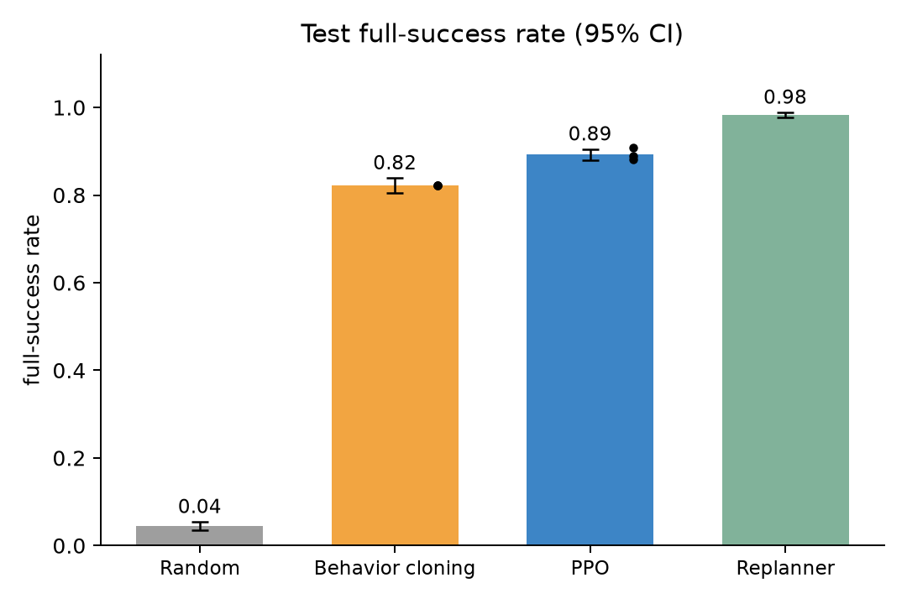

# Budgeted Stochastic Scene Repair

CPS 379 Reinforcement Learning, Fall 2026: final project (Binayak Jha, solo).

A tiny RL benchmark. Fix a 5×5 grid scene so that it meets goals like "box is in the
center" or "book is directly south of box". You have **8 paid actions**, and **moves are
unreliable**: a legal move works 70% of the time, jitters to a nearby cell 20% of the time,
and does nothing 10% of the time. The only reward comes at the end:
`R = s × (0.75 + 0.25 × budget_left / 8)`, where `s` is the share of goals met.


## Results (test set: 500 held-out scenes × 4 rollouts; BC and PPO pooled over 3 seeds)

| Policy | Full success | Mean R | Actions used |
|---|---|---|---|
| Random | 4.4% [3.5, 5.4] | 0.280 [0.267, 0.292] | 6.37 |
| Behavior cloning | 82.3% [80.6, 83.9] | 0.829 [0.820, 0.838] | 3.42 |
| PPO | 89.3% [88.0, 90.5] | 0.870 [0.863, 0.877] | 2.98 |
| Adaptive replanner (A*) | **98.3%** [97.7, 98.9] | **0.912** [0.907, 0.917] | 2.64 |

Brackets are 95% bootstrap CIs over test scenes. The replanner wins, which the proposal
called a valid outcome. PPO learns from the end reward alone and beats behavior cloning.
Turning the noise off helps every policy. Turning UNDO off changes almost nothing.
All tables are in `results/results_table.md` and `results/test_results.json`.



## Run it

```bash
python -m venv .venv && source .venv/bin/activate
pip install -r requirements.txt
python -m pytest -q tests      # unit tests
python run_all.py --quick      # ~1 min end-to-end check (writes results/quick/)
python run_all.py              # full study, ~18 min on 8 CPU cores
python docs/build_guide.py     # rebuild the guide from saved results (needs google-chrome)
```

## Layout

```
scene_repair/        the package (each file has one job, explained in its top docstring)
  grid.py            board, directions, steps
  constraints.py     the 3 goal types and the exact checker
  scenes.py          puzzle generator, train/val/test splits
  env.py             the Gymnasium environment (rules, noise, undo, budget, reward)
  encoding.py        state -> 243 numbers for the neural net
  networks.py        small policy + value network with action masking
  evaluation.py      play episodes, bootstrap CIs
  settings.py        every experiment knob in one place
  policies/          random_policy.py, planner.py, bc.py, ppo.py
scripts/             make_splits, train_bc, train_ppo, evaluate, failure_analysis,
                     scene_stats, make_figures, make_episode_gif
tests/               unit tests (incl. the proposal's worked example, R = 0.875)
results/             frozen splits, curves, models, test results, tuning notes
figures/             all plots (matplotlib), plus ppo_episode.gif
docs/                code_guide.html / .pdf and its builder
run_all.py           reproduces everything
```
